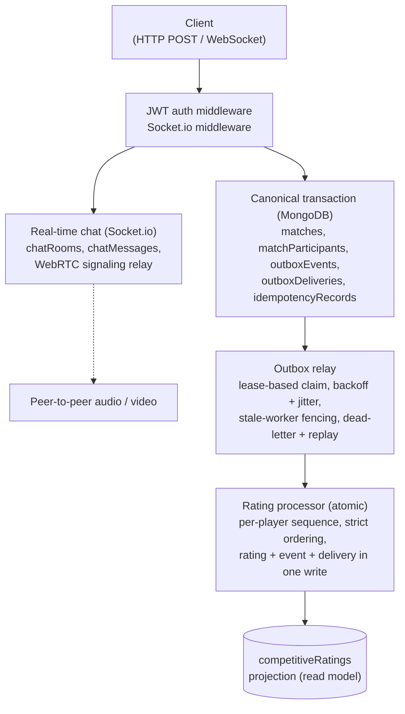

<div align="center">

# 🎮 FPS Game Database

**A cloud-deployed backend for competitive FPS games.**

Canonical match recording, transactional outbox, sequence-ordered Elo ratings, matchmaking, tournaments, moderation, and real-time communications (chat, friends, WebRTC calls), built so every match result is recorded once and only once, even when networks and workers fail.

[](https://github.com/shaurya-10000/fps-game-database/actions/workflows/ci.yml)
[](./LICENSE)
[](https://nodejs.org)
[](https://www.mongodb.com/atlas)
[](https://www.typescriptlang.org)
[](https://socket.io)

[**Live API Health Check**](https://fps-game-database.onrender.com/health) · [**Report a bug**](https://github.com/shaurya-10000/fps-game-database/issues)

</div>

---

## Contents

- [Highlights](#highlights)
- [Features](#features)
- [Architecture](#architecture)
- [Game content catalog](#game-content-catalog)
- [Core guarantees](#core-guarantees)
- [Tech stack](#tech-stack)
- [Quick start](#quick-start)
- [Scripts](#scripts)
- [Testing](#testing)
- [Deployment](#deployment)
- [Operations and documentation](#operations-and-documentation)
- [Security](#security)
- [Troubleshooting](#troubleshooting)
- [License](#license)

## Highlights

- **Exactly-once effect.** Match results are recorded once, even if clients retry, networks drop acknowledgements, or workers crash mid-flight.
- **Event-driven projections.** Ratings, XP, and leaderboards are derived asynchronously through a transactional outbox. They can be rebuilt from scratch without touching canonical data.
- **Real-time communications.** Socket.io handles authenticated, bi-directional WebSocket connections for Global, Region, Group, and DM chat, and acts as a signaling relay for peer-to-peer WebRTC voice and video calls.
- **Strict ordering.** Per-player rating sequences are enforced atomically. Out-of-order events are deferred, duplicates are no-ops, and gaps block application until resolved.
- **Security by design.** BOLA-safe responses (404 instead of 403), Zod-strict mass-assignment defense, JWT verification against a JWKS, socket-level JWT authentication, and mid-session suspension enforcement.
- **Typed game content model.** Maps, weapons with full ballistics, characters, throwables, equipment, and game modes are strictly typed TypeScript domain models, seeded into versioned catalogs that matches pin to.
- **Deployed and running.** The REST API and WebSocket server run on Render against a managed MongoDB Atlas cluster. Background workers run separately from the HTTP server.
- **Tested against a real database.** 106 passing tests (24 unit, 82 integration) cover concurrency, failure injection, crash recovery, social graph race conditions, and state machines. Integration tests use real MongoDB transactions, not mocks.

## Features

| Area | What it does |
| :--- | :--- |
| **Canonical match results** | Versioned content catalog, match lifecycle state machine, idempotent result submission, ambiguous-commit resolution |
| **Outbox and consumers** | Lease-based claiming, exponential backoff with jitter, dead-lettering with replay, backpressure monitoring |
| **Competitive ratings** | Elo rating algorithm, tier derivation, audited rating corrections, season lifecycle |
| **Stats and economy** | Rebuildable projections, cursor-paginated leaderboards, idempotent inventory grants, progression (XP) ledger |
| **Matchmaking** | Ticket state machine, atomic allocation, partial-claim prevention, cancellation-vs-allocation race handling, allocator crash recovery |
| **Tournaments** | Immutable bracket revisions, idempotent bracket advancement |
| **Moderation and audit** | Report and sanction workflow, audit events, admin route separation |
| **Social graph** | Friendships with mutual auto-accept, directional blocking (dominant over friendships), BOLA-safe error surfaces, in-flight request caps |
| **Real-time chat** | Authenticated WebSocket connections via Socket.io. Global, Region, and Group rooms, plus deterministic Direct Messages (DMs) |
| **WebRTC signaling** | Backend relay for peer-to-peer voice and video calls. Handles Offer, Answer, ICE candidate exchange, and call termination |
| **Content catalog** | Versioned, typed catalog of maps, weapons (with ballistics), characters, throwables, equipment, and game modes; every match pins to a catalog version |
| **Identity** | JWKS-validated JWTs, concurrent first-login safety, identity linking, account-status enforcement |
| **Operations** | Migrations, deterministic seeding, index/validator/constraint verification, graceful shutdown, runbooks |

## Architecture

Canonical truth, event-driven projections, and real-time communications.



<details>
<summary>Plain-text version of the diagram</summary>

```text
Client (HTTP POST / WebSocket)
       |
       v
[JWT Auth Middleware / Socket.io Middleware]
       |
       +---------------------------------------+
       |                                       |
       v                                       v
+---------------------------------------+  +---------------------------------------+
|  Canonical Transaction (MongoDB)      |  |  Real-time Chat (Socket.io)           |
|  ---------------------------------    |  |  ---------------------------------    |
|  matches (status: completed)          |  |  chatRooms (global, region, group)    |
|  matchParticipants (N documents)      |  |  chatMessages (indexed by room/time)  |
|  outboxEvents (1 MATCH_COMPLETED)     |  |  WebRTC Signaling (P2P relay)         |
|  outboxDeliveries (1 per consumer)    |  +---------------------------------------+
|  idempotencyRecords (fingerprint)     |                      |
+---------------------------------------+                      v
       |                                             Peer-to-Peer Audio/Video
       v
+---------------------------------------+
|  Outbox Relay (lease-based claim)     |
|  ---------------------------------    |
|  Exponential backoff + jitter         |
|  Stale-worker protection              |
|  Dead-letter + replay script          |
+---------------------------------------+
       |
       v
+---------------------------------------+
|  Rating Processor (atomic)            |
|  ---------------------------------    |
|  Per-player sequence allocation       |
|  Strict ordering enforcement          |
|  Atomic: rating + event + delivery    |
+---------------------------------------+
       |
       v
  competitiveRatings projection (read model)
```

</details>

### Design principles

1. **One transactional write path.** A match result, its participants, its outbox event, its per-consumer deliveries, and its idempotency record commit together or not at all.
2. **Real-time is stateless.** Chat messages are persisted, but WebRTC call signaling is relayed in-memory for maximum speed and minimal database load.
3. **Projections are disposable.** Read models can be rebuilt from canonical data.
4. **At-least-once delivery, exactly-once effect.** The relay may redeliver; consumers are idempotent and enforce ordering.
5. **Fail closed.** Unknown fields are rejected, unauthorized access looks like absence, and ambiguous states are resolved explicitly.

### Failure model

| Failure | Behavior |
| :--- | :--- |
| Concurrent duplicate submission | One canonical record; others resolve through the idempotency record |
| Error inside the transaction | Full rollback, no partial state |
| Commit succeeds but the ACK is lost | Retry resolves to the committed result |
| Relay worker crashes mid-delivery | Lease expires, another worker claims; the stale worker is fenced out |
| Consumer keeps failing | Backoff with jitter, then dead-letter; replay with a script |
| Rating event arrives out of order | Gap detected; application deferred until order is restored |
| Concurrent friend accept | Unique index on reverse direction ensures exactly one pair is created |
| Socket connection drops | Client auto-reconnects via Socket.io, re-authenticates, and rejoins rooms |
| WebRTC target offline | Signaling event is dropped; client times out waiting for Answer |

## Game content catalog

The database is seeded with a full, original-IP content catalog, showing it can model rich relational game data: weapons, economy, maps, and characters. Every match is pinned to a catalog version, so results keep resolving correctly even after the catalog changes (`v2` extends `v1`). The tables below describe the `v1` catalog.

### 🗺️ Maps (10)

| Name | Size | Supported modes |
| :--- | :--- | :--- |
| **Redline** | Medium | Team Deathmatch, Bomb Defusal |
| **Caravan** | Large | Bomb Defusal, Battle Royale |
| **Glacier** | Small | Bomb Defusal, Free-for-All |
| **Emberfall** | Medium | Team Deathmatch, Bomb Defusal, Battle Royale |
| **Terrace** | Small | Free-for-All, Team Deathmatch |
| **Brine** | Large | Bomb Defusal, Battle Royale |
| **Monolith** | Medium | Bomb Defusal, Battle Royale |
| **Ashfall** | Medium | Team Deathmatch, Free-for-All |
| **Crosswinds** | Small | Free-for-All, Team Deathmatch |
| **Undertow** | Large | Bomb Defusal, Battle Royale |

### 🔫 Weapons (35)

Five weapons per category. Every weapon carries a full ballistics profile, not just a damage number.

| Stat | Meaning |
| :--- | :--- |
| `damage`, `minDamage` | Body damage up close, and the floor reached at long range |
| `falloffStartMeters`, `falloffEndMeters` | Where damage starts dropping and where it reaches `minDamage` |
| `rangeMeters` | Maximum effective range |
| `fireRate`, `isAutomatic` | Rounds per minute, and whether the weapon fires automatically |
| `magazineSize`, `reloadTimeMs` | Ammo capacity and reload duration |
| `headshotMultiplier` | Damage multiplier on headshots |
| `recoilVertical`, `recoilHorizontal` | Recoil kick in degrees |
| `spread` | Base inaccuracy in degrees |
| `penetration` | 0 none, 1 low, 2 medium, 3 high |

One representative weapon per category (full data lives in `src/domain/catalog/data.ts`):

| Weapon | Type | Damage (min) | RPM | Mag | Reload | HS × | Range (falloff) | Recoil V/H | Spread | Pen |
| :--- | :--- | :--- | :--- | :--- | :--- | :--- | :--- | :--- | :--- | :--- |
| **Wraith** | Assault Rifle | 36 (28) | 600 | 30 | 2.5s | 4.0 | 50m (20-40m) | 2.5 / 1.2 | 0.5 | 2 |
| **Viper** | SMG | 27 (18) | 750 | 30 | 2.8s | 4.0 | 30m (10-25m) | 1.5 / 1.8 | 0.8 | 1 |
| **Hammerfall** | Sniper | 115 (115) | 41 | 10 | 3.7s | 4.0 | 100m (no falloff) | 8.0 / 2.0 | 0.1 | 3 |
| **Bulwark** | LMG | 35 (28) | 800 | 150 | 5.5s | 4.0 | 60m (30-55m) | 3.5 / 2.5 | 1.5 | 3 |
| **Judge** | Pistol | 63 (48) | 267 | 7 | 2.2s | 4.0 | 25m (10-20m) | 2.5 / 1.0 | 0.6 | 2 |
| **Thunder** | Shotgun | 26 (8) | 85 | 8 | 2.6s | 3.0 | 15m (5-12m) | 4.0 / 1.5 | 3.0 | 1 |
| **Tactical Blade** | Melee | 55 (55) | 120 | n/a | n/a | n/a | 2m | none | 0 | 0 |

| Category | Weapons |
| :--- | :--- |
| **Assault Rifle** | Wraith, Havoc, Sentinel, Warden, Raptor |
| **SMG** | Viper, Hornet, Bolt, Wasp, Needle |
| **Sniper** | Hammerfall, Coldshot, Railgun, Longshot, Apexbreaker |
| **LMG** | Bulwark, Avalanche, Thunderhead, Ironbell, Siegeheart |
| **Pistol** | Sidearm, Whisper, Judge, Flashpoint, Clawback |
| **Shotgun** | Thunder, Striker, Scattershot, Breaker, Bastion |
| **Melee** | Tactical Blade, Void Edge Dagger, Rift Cleaver, Ironfang, Nightreaver |

### 🧑‍🚀 Characters (25)

Five characters per role class.

| Role | Characters |
| :--- | :--- |
| **Assault** | Vandal, Ravager, Pyre, Riptide, Hawkeye |
| **Sniper** | Coldshot, Lattice, Nightfall, Talon, Vigil |
| **Controller** | Umbra, Aegisveil, Miasma, Skywarden, Duskbrand |
| **Support** | Vital, Lifeline, Mender, Symbiotic, Halo |
| **Tank** | Bulwark, Foundation, Ironhide, Anchor, Stonewall |

### 💣 Throwables and 🛡️ Equipment

- **Throwables (8):** Shattercore, Veilcloud, Blindlight, Cinderwave, Phantom Echo, Nullburst, Lifebloom, Quakejaw.
- **Equipment (13):** 3 armor levels (Light, Medium, Heavy), 3 helmet levels, 6 ammo types (one per ranged weapon class), and 1 med kit.

### 🎮 Game modes and matchmaking (2 buckets × 4 modes)

Matchmaking supports **Ranked** and **Unranked** buckets across four core modes.

| Mode | Team size | Rounds | Supported buckets |
| :--- | :--- | :--- | :--- |
| **Team Deathmatch** | 5v5 | 1 | Ranked, Unranked |
| **Free-for-All** | Solo (everyone vs everyone) | 1 | Ranked, Unranked |
| **Bomb Defusal** | 5v5 | 7 | Ranked, Unranked |
| **Battle Royale** | Solo, Duo, Trio, Squad (up to 5) | 1 | Ranked, Unranked |

### Content model

The catalog is a strictly typed domain model. Weapon stats, for example:

```ts
export interface WeaponStats {
  damage: number;
  fireRate: number;            // rounds per minute
  magazineSize: number;
  reloadTimeMs: number;
  headshotMultiplier: number;
  rangeMeters: number;
  falloffStartMeters: number;
  falloffEndMeters: number;
  minDamage: number;
  recoilVertical: number;      // degrees
  recoilHorizontal: number;    // degrees
  spread: number;              // degrees
  penetration: number;         // 0-3
  isAutomatic: boolean;
}
```

Weapon types, throwable types, character roles, game modes, and matchmaking buckets are closed union types, so an invalid value fails at compile time rather than at runtime. Seed the catalog with `npm run seed:catalog`.

## Core guarantees

| Guarantee | How it is proven |
| :--- | :--- |
| Zero duplicate canonical records under concurrent submission | 20-parallel test (`duplicate-load.test.ts`) |
| Full transaction rollback on any failure point | Failure injection (`canonical-result.test.ts`) |
| Ambiguous commit resolution (network drops ACK) | `ambiguous-commit.test.ts` |
| Exactly-once rating across crashes and retries | Worker crash recovery test |
| No out-of-order application | Sequence gap detection test |
| BOLA protection (404, not 403, on unauthorized) | `auth-middleware.test.ts` |
| Mass-assignment rejection at DB and API layer | Zod `.strict()` + `additionalProperties: false` |
| Mid-session account suspension enforcement | High-risk route re-check test |
| Exactly-once friendship creation under concurrent accept | `friends.test.ts` |
| Block prevents future requests in both directions | `friends.test.ts` |

## Tech stack

| Layer | Choice |
| :--- | :--- |
| Runtime | [Node.js](https://nodejs.org) (>= 20.19.0) |
| Language | [TypeScript](https://www.typescriptlang.org) (strict, no `any`) |
| HTTP server | [Express](https://expressjs.com) |
| Real-time | [Socket.io](https://socket.io) (chat and WebRTC signaling) |
| Database | [MongoDB Atlas](https://www.mongodb.com/atlas) (replica set) |
| Validation | [Zod](https://zod.dev) (strict schemas) |
| Auth | [jose](https://github.com/panva/jose) (JWKS, JWT) |
| Testing | [Vitest](https://vitest.dev) |
| CI/CD | GitHub Actions → Render |

## Quick start

**Prerequisites:** Node.js **20.19.0+**, npm, and a MongoDB Atlas cluster. Every Atlas cluster, including the free tier, is a replica set, which multi-document transactions require.

```bash
git clone https://github.com/shaurya-10000/fps-game-database.git
cd fps-game-database
npm install
cp .env.example .env        # set MONGODB_URI to your Atlas connection string
```

Run the API locally:

```bash
npm run dev
```

The server starts on `http://localhost:3000`. Verify it:

```bash
curl http://localhost:3000/health
# {"status":"ok","env":"development"}
```

## Scripts

| Script | Purpose |
| :--- | :--- |
| `npm run dev` | Start the API in development mode |
| `npm run build` | Compile `src/` to `dist/` |
| `npm start` | Run the compiled API |
| `npm run start:worker` | Run the background worker (outbox relay + rating processor) |
| `npm run typecheck` | Strict typecheck, including tests |
| `npm test` | Unit tests |
| `npm run test:integration` | Integration tests against Atlas |
| `npm run ci` | What CI runs: typecheck + build + test |
| `npm run seed -- --size=small` | Seed a deterministic dataset |
| `npm run seed:catalog` | Seed the versioned content catalog |
| `npm run verify:validators` | Verify collection JSON Schema validators |
| `npm run verify:indexes` | Verify the index inventory matches the database |
| `npm run verify:unique` | Verify unique constraints |
| `npm run verify:explain` | Verify query plans use indexes |
| `npm run verify:backup-restore` | Verify referential integrity |
| `npm run migrate` | Run idempotent migrations (`--dry-run` supported) |
| `npm run replay:dead-letter <id>` | Replay a dead-lettered delivery |

## Testing

The repository contains 106 tests across 42 files: 24 unit tests and 82 integration tests.

```bash
npm test                  # Unit tests (fast, hermetic)
npm run test:integration  # Integration tests (requires Atlas)
```

> [!WARNING]
> Integration tests need a valid `MONGODB_URI` in `.env` and run heavy concurrent operations against your Atlas cluster. Use a dedicated or disposable cluster, not data you care about.

Catalog tests assert exact content counts (10 maps, 35 weapons, 25 characters, 8 throwables, 13 equipment items, 4 game modes), five weapons per type, five characters per role, complete ballistics on every weapon, and game-mode rules such as the 7-round 5v5 Bomb Defusal.

Coverage includes concurrent duplicate submission, transaction rollback via failure injection, lost-ACK recovery, worker crash recovery, sequence ordering, matchmaking races, bracket idempotency, concurrent friend accept, directional blocking, and authorization boundaries.

## Deployment

### Render (API)

The API runs as a Web Service on Render.

1. Build command: `npm install --include=dev && npm run build`
2. Start command: `npm start`
3. Environment variables: `MONGODB_URI`, `NODE_ENV=production`, `AUTH_JWKS_URI`, `AUTH_ISSUER`, `AUTH_AUDIENCE`

> [!NOTE]
> If the instance has been idle, the first request to the live health check may take a while to respond.

### Background worker (outbox relay)

By design, the HTTP server only handles canonical writes. Projection workers (`OutboxRelay`, `RatingProcessor`) run as a separate, continuous process. To process ratings in a deployment, run a Render **Background Worker** with:

```bash
npm run start:worker
```

## Operations and documentation

| Document | Purpose |
| :--- | :--- |
| [`threat-model.md`](docs/threat-model/threat-model.md) | Security boundaries and accepted risks |
| [`security-review.md`](docs/security/security-review.md) | OWASP API Top 10 coverage |
| [`index-inventory.md`](docs/architecture/index-inventory.md) | Every index, justified |
| [`statistics-definitions.md`](docs/architecture/statistics-definitions.md) | Stat calculation rules |
| [`match-pipeline-trace.md`](docs/operations/match-pipeline-trace.md) | End-to-end trace of one match |
| [`slo.md`](docs/operations/slo.md) | Service level objectives |
| [`load-test-results.md`](docs/operations/load-test-results.md) | Load test results and method |
| [`backup-restore-drill.md`](docs/operations/backup-restore-drill.md) | Restore drill record |
| [`sample-logs.md`](docs/operations/sample-logs.md) | Structured log format |
| [`runbooks/`](docs/operations/runbooks/) | Incident response |

## Security

- JWTs are verified against a JWKS with issuer, audience, and expiry checks.
- WebSocket connections are authenticated using the same JWT middleware as HTTP.
- Unauthorized access to another player's resources returns 404, not 403, to avoid leaking existence.
- Blocking a player hides your presence from them and prevents future friend requests or DMs.
- Request bodies use strict schemas (unknown fields rejected), with matching validators at the database layer.
- High-risk routes re-check account status, so suspensions apply mid-session.
- Admin routes are separated and audited.

To report a vulnerability, please use GitHub's private vulnerability reporting on this repository rather than a public issue.

## Troubleshooting

| Symptom | Likely cause | Fix |
| :--- | :--- | :--- |
| "Transaction numbers are only allowed on a replica set member" | MongoDB running standalone | Use MongoDB Atlas (replica set by default) |
| Integration tests fail to connect | Wrong or missing `MONGODB_URI` | Check `.env` against `.env.example`; allow your IP in Atlas network access |
| `npm install` fails on engine check | Node older than 20.19.0 | Upgrade Node |
| `verify:indexes` reports drift | Migration not applied | Run `npm run migrate`, then re-verify |
| Ratings never update in a deployment | Worker not running | Start the background worker (`npm run start:worker`) |
| Deliveries stuck in dead-letter | Persistent consumer failure | Fix the root cause, then `npm run replay:dead-letter <id>` |
| Chat connects but no messages appear | Client not emitting `join_room` | Ensure the client joins `global_chat` or the correct DM room ID |
| WebRTC call fails to connect | STUN/TURN server unreachable | Check client ICE configuration; ensure both peers are online |

## License

Released under the MIT license. See [LICENSE](./LICENSE).

---

<div align="center">

Built by [shaurya-10000](https://github.com/shaurya-10000) · [Report a bug](https://github.com/shaurya-10000/fps-game-database/issues)

</div>