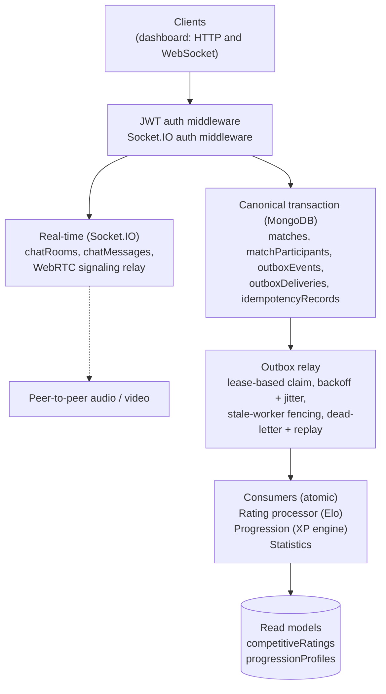

<div align="center">

# 🎮 FPS Game Database

**A cloud-deployed backend for competitive FPS games.**

Canonical match recording, transactional outbox, sequence-ordered Elo ratings, matchmaking, tournaments, moderation, real-time communications (chat, group chats, friends, WebRTC signaling) and mode-aware XP progression. Built so every match result is recorded once and only once, even when networks and workers fail.

[](https://github.com/shaurya-10000/fps-game-database/actions/workflows/ci.yml)
[](./LICENSE)
[](https://nodejs.org)
[](https://www.mongodb.com/atlas)
[](https://www.typescriptlang.org)
[](https://socket.io)

[**Live API health check**](https://fps-game-database.onrender.com/health) · [**Frontend repo**](https://github.com/shaurya-10000/fps-game-database-web) · [**Report a bug**](https://github.com/shaurya-10000/fps-game-database/issues)

</div>

> **Two repos, one product.** This repo is the backend: REST API, WebSocket server and background workers. The player dashboard lives in [`fps-game-database-web`](https://github.com/shaurya-10000/fps-game-database-web) (Next.js) and consumes everything documented here.

---

## Contents

- [Highlights](#highlights)
- [Features](#features)
- [Architecture](#architecture)
- [REST API overview](#rest-api-overview)
- [Chat API and socket events](#chat-api-and-socket-events)
- [Game content catalog](#game-content-catalog)
- [Core guarantees](#core-guarantees)
- [Tech stack](#tech-stack)
- [Quick start](#quick-start)
- [Environment variables](#environment-variables)
- [Scripts](#scripts)
- [Testing](#testing)
- [Deployment](#deployment)
- [Operations and documentation](#operations-and-documentation)
- [Security](#security)
- [Troubleshooting](#troubleshooting)
- [Known limitations](#known-limitations)
- [License](#license)

## Highlights

- **Exactly-once effect.** Match results are recorded once, even if clients retry, networks drop acknowledgements, or workers crash mid-flight.
- **Event-driven projections.** Ratings, XP and leaderboards are derived asynchronously through a transactional outbox and can be rebuilt from scratch without touching canonical data.
- **Strict ordering.** Per-player rating sequences are enforced atomically. Out-of-order events are deferred, duplicates are no-ops, and gaps block application until resolved.
- **Real-time communications.** Authenticated Socket.IO connections power Global, Region, Group and DM chat, and act as a signaling relay for peer-to-peer WebRTC voice and video calls.
- **Full-featured chat.** Group chats with admins, replies, reactions, edit and delete, pins, server-side search and paged history, with membership enforced on every room.
- **Mode-aware progression.** K/D matters in Team Deathmatch, survival time in Battle Royale, and the leveling curve gets harder as players rank up.
- **Security by design.** BOLA-safe responses (404, not 403), Zod-strict mass-assignment defense, JWT verification against a JWKS, socket-level JWT auth, room-level access checks and mid-session suspension enforcement.
- **Typed game content.** Maps, weapons with full ballistics, characters, throwables, equipment and modes are strictly typed domain models, seeded into versioned catalogs that every match pins to.
- **Deployed and running.** The API and WebSocket server run on Render against a managed MongoDB Atlas cluster; background workers run as a separate process.
- **Tested against a real database.** 106 passing tests (24 unit, 82 integration) cover concurrency, failure injection, crash recovery, social-graph races and state machines. Integration tests use real MongoDB transactions, not mocks.

## Features

| Area | What it does |
| :--- | :--- |
| **Canonical match results** | Versioned content catalog, match lifecycle state machine, idempotent result submission, ambiguous-commit resolution |
| **Outbox and consumers** | Lease-based claiming, exponential backoff with jitter, dead-lettering with replay, backpressure monitoring |
| **Competitive ratings** | Elo algorithm, tier derivation, audited rating corrections, season lifecycle |
| **Progression and XP** | Mode-aware XP calculation, progressive leveling curve, transaction-safe multi-level-ups |
| **Stats and economy** | Rebuildable projections, cursor-paginated leaderboards, idempotent inventory grants, XP ledger |
| **Matchmaking** | Ticket state machine, atomic allocation, partial-claim prevention, cancel-vs-allocate race handling, allocator crash recovery |
| **Tournaments** | Immutable bracket revisions, idempotent bracket advancement |
| **Moderation and audit** | Report and sanction workflow, audit events, admin route separation |
| **Social graph** | Friendships with mutual auto-accept, directional blocking (dominant over friendships), mutes, BOLA-safe error surfaces, in-flight request caps |
| **Real-time chat** | Global and Region rooms, deterministic DMs, live updates for edits, deletes, reactions and pins, typing, read receipts, presence |
| **Group chats** | Create from friends, rename, add and remove members, leave. Creator is admin; admin role passes on when the last admin leaves; system notices for membership changes |
| **Message features** | Replies with quoted previews, 8 fixed reactions, edit, delete for everyone, pins (50 per room), server-side search, paged history, voice messages |
| **WebRTC signaling** | In-memory relay of offer, answer, ICE candidates and call termination |
| **Content catalog** | Versioned, typed catalog of maps, weapons, characters, throwables, equipment and modes |
| **Identity** | JWKS-validated JWTs, concurrent first-login safety, identity linking, account-status enforcement |
| **Operations** | Migrations, deterministic seeding, index / validator / constraint verification, graceful shutdown, runbooks |

---

## Architecture

Canonical truth, event-driven projections and real-time communications.



### Design principles

1. **One transactional write path.** A match result, its participants, its outbox event, its per-consumer deliveries and its idempotency record commit together or not at all.
2. **Real-time is stateless.** Chat messages are persisted, but WebRTC signaling is relayed in memory for speed and minimal database load.
3. **Projections are disposable.** Read models can be rebuilt from canonical data.
4. **At-least-once delivery, exactly-once effect.** The relay may redeliver; consumers are idempotent and enforce ordering.
5. **Fail closed.** Unknown fields are rejected, unauthorized access looks like absence, and ambiguous states are resolved explicitly.

### Failure model

| Failure | Behavior |
| :--- | :--- |
| Concurrent duplicate submission | One canonical record; others resolve through the idempotency record |
| Error inside the transaction | Full rollback, no partial state |
| Commit succeeds but the ACK is lost | Retry resolves to the committed result |
| Relay worker crashes mid-delivery | Lease expires, another worker claims; the stale worker is fenced out |
| Consumer keeps failing | Backoff with jitter, then dead-letter; replay with a script |
| Rating event arrives out of order | Gap detected; application deferred until order is restored |
| Concurrent friend accept | Unique index on the reverse direction ensures exactly one pair is created |
| Socket connection drops | Client auto-reconnects, re-authenticates and rejoins rooms |
| WebRTC target offline | Signaling event is dropped; the caller times out waiting for an answer |
| Player levels up several times in one match | Transaction-safe loop applies levels until the XP is spent |
| Member removed from a group | Their live sockets leave the room immediately, so no further messages are delivered |

---

## REST API overview

All routes except health and login/register require `Authorization: Bearer <JWT>`. Clients connect to the REST API and WebSocket server on the same host (`http://localhost:3000` in development) with the same JWT. The chat routes are detailed [below](#chat-api-and-socket-events).

| Area | Endpoints |
| :--- | :--- |
| **Health** | `GET /health` |
| **Auth** | `POST /api/auth/login`, `POST /api/auth/register` |
| **Profile** | `GET` / `PATCH /api/me/profile`, `GET /api/me/progression`, `GET /api/me/overview` (rating, tier, rank, career stats, ranked record, rating history, recent matches) |
| **Friends** | `GET /api/me/friends`, `GET /api/me/friends/requests`, `GET /api/me/friends/requests/outgoing`, `POST /api/me/friends/requests`, `POST /api/me/friends/requests/:fromPlayerId/accept`, `DELETE /api/me/friends/requests/:otherId`, `DELETE /api/me/friends/:otherId` |
| **Search** | `GET /api/me/players/search?q=` |
| **Blocks and mutes** | `GET` / `POST /api/me/blocks`, `DELETE /api/me/blocks/:playerId`, `GET` / `POST /api/me/mutes`, `DELETE /api/me/mutes/:playerId` |
| **Leaderboards** | `GET /api/leaderboards` (cursor-paginated), `/global`, `/friends`, `/region/:region` |
| **Chat** | See [Chat API and socket events](#chat-api-and-socket-events) |

## Chat API and socket events

All routes are authenticated. Rooms are checked on every read and write: DM rooms belong to their two participants, group rooms to their members, and Global and Region rooms are open.

<details open>
<summary><strong>REST</strong></summary>

| Method | Path | Purpose |
| :--- | :--- | :--- |
| `GET` | `/api/chat/dm-by-id/:playerId` | Get or create the DM room with a friend |
| `GET` | `/api/chat/groups` | List the groups you belong to, with members |
| `POST` | `/api/chat/groups` | Create a group from friends: `{ name, memberIds }` |
| `GET` | `/api/chat/groups/:roomId` | Group details and members |
| `PATCH` | `/api/chat/groups/:roomId` | Rename (admin): `{ name }` |
| `POST` | `/api/chat/groups/:roomId/members` | Add friends: `{ memberIds }` |
| `DELETE` | `/api/chat/groups/:roomId/members/:playerId` | Remove a member (admin) or leave (yourself) |
| `GET` | `/api/chat/rooms/:roomId/history` | Older messages: `?before=<ISO>&limit=` (max 100) |
| `GET` | `/api/chat/rooms/:roomId/search` | Search messages: `?q=` (2 to 100 characters) |
| `GET` | `/api/chat/rooms/:roomId/pins` | Pinned messages |
| `POST` / `DELETE` | `/api/chat/rooms/:roomId/messages/:messageId/pin` | Pin or unpin (max 50 per room) |
| `PATCH` | `/api/chat/rooms/:roomId/messages/:messageId` | Edit your own text message: `{ content }` |
| `DELETE` | `/api/chat/rooms/:roomId/messages/:messageId` | Delete for everyone (author, or group admin) |
| `POST` | `/api/chat/rooms/:roomId/messages/:messageId/reactions` | Toggle a reaction: `{ emoji }` (fixed set of 8) |
| `POST` | `/api/chat/rooms/:roomId/voice` | Upload a voice message (multipart) |
| `GET` | `/api/chat/rooms/:roomId/reads` | When each participant last read the room |
| `GET` | `/api/chat/unread` | Unread counts (up to 99) for your DMs and groups |
| `POST` | `/api/chat/calls` | Save a finished call into the DM: `{ peerId, kind, outcome, durationSec }` |

</details>

<details open>
<summary><strong>Socket events</strong></summary>

| Direction | Event | Payload |
| :--- | :--- | :--- |
| Client → server | `join_room` | `roomId` |
| Client → server | `send_message` | `{ roomId, content, replyToId? }` (max 2000 characters, rate limited to 20 per 10 s) |
| Client → server | `typing` | `{ roomId, typing }`, relayed to others in the room (throttled) |
| Client → server | `mark_read` | `{ roomId }`, records how far you have read (throttled) |
| Client → server | `call_user`, `answer_call`, `ice_candidate`, `end_call` | WebRTC signaling payloads with `targetPlayerId` |
| Server → client | `room_history` | Latest 50 messages, oldest first |
| Server → client | `new_message` | Message, including system notices |
| Server → client | `message_edited`, `message_deleted` | `{ roomId, messageId, ... }` |
| Server → client | `message_reactions` | `{ roomId, messageId, reactions }` |
| Server → client | `message_pinned`, `message_unpinned` | `{ roomId, messageId, pinned? }` |
| Server → client | `group_updated` | `{ roomId }`, sent to current and removed members |
| Server → client | `typing` | `{ roomId, playerId, name, typing }` |
| Server → client | `chat_activity` | `{ roomId, kind, senderId, senderName, preview, messageId, createdAt }`, sent to the other members of a DM or group for unread badges |
| Server → client | `read_receipt` | `{ roomId, playerId, at }` |
| Server → client | `presence_snapshot`, `presence` | `{ online: string[] }` on connect, then `{ playerId, online }` as friends come and go |
| Server → client | `incoming_call`, `call_answered`, `ice_candidate`, `call_ended` | The signaling payloads, tagged with `fromPlayerId` |
| Server → client | `error` | Human-readable string |

</details>

> [!NOTE]
> Presence is tracked in memory, so it is accurate per server instance. Run a single API instance, or add a shared store such as Redis before scaling out.

---

## Game content catalog

The database is seeded with a full, original-IP catalog that shows it can model rich relational game data. Every match is pinned to a catalog version, so results keep resolving correctly after the catalog changes (`v2` extends `v1`). The tables below describe `v1`.

<details>
<summary><strong>🗺️ Maps (10)</strong></summary>

| Name | Size | Supported modes |
| :--- | :--- | :--- |
| **Redline** | Medium | Team Deathmatch, Bomb Defusal |
| **Caravan** | Large | Bomb Defusal, Battle Royale |
| **Glacier** | Small | Bomb Defusal, Free-for-All |
| **Emberfall** | Medium | Team Deathmatch, Bomb Defusal, Battle Royale |
| **Terrace** | Small | Free-for-All, Team Deathmatch |
| **Brine** | Large | Bomb Defusal, Battle Royale |
| **Monolith** | Medium | Bomb Defusal, Battle Royale |
| **Ashfall** | Medium | Team Deathmatch, Free-for-All |
| **Crosswinds** | Small | Free-for-All, Team Deathmatch |
| **Undertow** | Large | Bomb Defusal, Battle Royale |

</details>

<details>
<summary><strong>🔫 Weapons (35)</strong></summary>

Five weapons per category, each with a full ballistics profile rather than a single damage number.

| Stat | Meaning |
| :--- | :--- |
| `damage`, `minDamage` | Body damage up close, and the floor reached at long range |
| `falloffStartMeters`, `falloffEndMeters` | Where damage starts dropping and where it reaches `minDamage` |
| `rangeMeters` | Maximum effective range |
| `fireRate`, `isAutomatic` | Rounds per minute, and whether the weapon fires automatically |
| `magazineSize`, `reloadTimeMs` | Ammo capacity and reload duration |
| `headshotMultiplier` | Damage multiplier on headshots |
| `recoilVertical`, `recoilHorizontal` | Recoil kick in degrees |
| `spread` | Base inaccuracy in degrees |
| `penetration` | 0 none, 1 low, 2 medium, 3 high |

One representative weapon per category (full data in `src/domain/catalog/data.ts`):

| Weapon | Type | Damage (min) | RPM | Mag | Reload | HS × | Range (falloff) | Recoil V/H | Spread | Pen |
| :--- | :--- | :--- | :--- | :--- | :--- | :--- | :--- | :--- | :--- | :--- |
| **Wraith** | Assault Rifle | 36 (28) | 600 | 30 | 2.5s | 4.0 | 50m (20-40m) | 2.5 / 1.2 | 0.5 | 2 |
| **Viper** | SMG | 27 (18) | 750 | 30 | 2.8s | 4.0 | 30m (10-25m) | 1.5 / 1.8 | 0.8 | 1 |
| **Hammerfall** | Sniper | 115 (115) | 41 | 10 | 3.7s | 4.0 | 100m (no falloff) | 8.0 / 2.0 | 0.1 | 3 |
| **Bulwark** | LMG | 35 (28) | 800 | 150 | 5.5s | 4.0 | 60m (30-55m) | 3.5 / 2.5 | 1.5 | 3 |
| **Judge** | Pistol | 63 (48) | 267 | 7 | 2.2s | 4.0 | 25m (10-20m) | 2.5 / 1.0 | 0.6 | 2 |
| **Thunder** | Shotgun | 26 (8) | 85 | 8 | 2.6s | 3.0 | 15m (5-12m) | 4.0 / 1.5 | 3.0 | 1 |
| **Tactical Blade** | Melee | 55 (55) | 120 | n/a | n/a | n/a | 2m | none | 0 | 0 |

| Category | Weapons |
| :--- | :--- |
| **Assault Rifle** | Wraith, Havoc, Sentinel, Warden, Raptor |
| **SMG** | Viper, Hornet, Bolt, Wasp, Needle |
| **Sniper** | Hammerfall, Coldshot, Railgun, Longshot, Apexbreaker |
| **LMG** | Bulwark, Avalanche, Thunderhead, Ironbell, Siegeheart |
| **Pistol** | Sidearm, Whisper, Judge, Flashpoint, Clawback |
| **Shotgun** | Thunder, Striker, Scattershot, Breaker, Bastion |
| **Melee** | Tactical Blade, Void Edge Dagger, Rift Cleaver, Ironfang, Nightreaver |

</details>

<details>
<summary><strong>🧑‍🚀 Characters (25), 💣 throwables (8) and 🛡️ equipment (13)</strong></summary>

| Role | Characters |
| :--- | :--- |
| **Assault** | Vandal, Ravager, Pyre, Riptide, Hawkeye |
| **Sniper** | Coldshot, Lattice, Nightfall, Talon, Vigil |
| **Controller** | Umbra, Aegisveil, Miasma, Skywarden, Duskbrand |
| **Support** | Vital, Lifeline, Mender, Symbiotic, Halo |
| **Tank** | Bulwark, Foundation, Ironhide, Anchor, Stonewall |

- **Throwables (8):** Shattercore, Veilcloud, Blindlight, Cinderwave, Phantom Echo, Nullburst, Lifebloom, Quakejaw.
- **Equipment (13):** 3 armor levels (Light, Medium, Heavy), 3 helmet levels, 6 ammo types (one per ranged weapon class) and 1 med kit.

</details>

### 🎮 Game modes and matchmaking

Matchmaking supports **Ranked** and **Unranked** buckets across four core modes (2 buckets × 4 modes). XP is calculated contextually per mode.

| Mode | Team size | Rounds | XP priority |
| :--- | :--- | :--- | :--- |
| **Team Deathmatch** | 5v5 | 1 | Kills, damage dealt, fewer deaths |
| **Free-for-All** | Solo (everyone vs everyone) | 1 | Kills, damage dealt, fewer deaths |
| **Bomb Defusal** | 5v5 | 7 | Kills, objective score |
| **Battle Royale** | Solo, Duo, Trio, Squad (up to 5) | 1 | Survival time, kills |

### Content model

The catalog is a strictly typed domain model:

```ts
export interface WeaponStats {
  damage: number;
  fireRate: number;            // rounds per minute
  magazineSize: number;
  reloadTimeMs: number;
  headshotMultiplier: number;
  rangeMeters: number;
  falloffStartMeters: number;
  falloffEndMeters: number;
  minDamage: number;
  recoilVertical: number;      // degrees
  recoilHorizontal: number;    // degrees
  spread: number;              // degrees
  penetration: number;         // 0-3
  isAutomatic: boolean;
}
```

Weapon types, throwable types, character roles, game modes and matchmaking buckets are closed union types, so an invalid value fails at compile time rather than at runtime. Seed the catalog with `npm run seed:catalog`.

---

## Core guarantees

| Guarantee | How it is proven |
| :--- | :--- |
| Zero duplicate canonical records under concurrent submission | 20-parallel test (`duplicate-load.test.ts`) |
| Full transaction rollback on any failure point | Failure injection (`canonical-result.test.ts`) |
| Ambiguous-commit resolution (network drops the ACK) | `ambiguous-commit.test.ts` |
| Exactly-once rating across crashes and retries | Worker crash recovery test |
| No out-of-order application | Sequence gap detection test |
| BOLA protection (404, not 403, on unauthorized access) | `auth-middleware.test.ts` |
| Mass-assignment rejection at DB and API layer | Zod `.strict()` + `additionalProperties: false` |
| Mid-session account suspension enforcement | High-risk route re-check test |
| Exactly-once friendship creation under concurrent accept | `friends.test.ts` |
| Blocking prevents future requests in both directions | `friends.test.ts` |

## Tech stack

| Layer | Technology |
| :--- | :--- |
| **Runtime and language** | Node.js 20.19+, TypeScript (strict), Express |
| **Data** | MongoDB Atlas (replica set, multi-document transactions) |
| **Validation and auth** | Zod, JWT verified against a JWKS |
| **Real-time** | Socket.IO, WebRTC (signaling only) |
| **Testing and CI** | Vitest, GitHub Actions |
| **Hosting** | Render (web service and background worker), MongoDB Atlas |

---

## Quick start

**Prerequisites:** Node.js **20.19.0+**, npm, and a MongoDB Atlas cluster. Every Atlas cluster, including the free tier, is a replica set, which multi-document transactions require. A standalone `mongod` will not work.

```bash
git clone https://github.com/shaurya-10000/fps-game-database.git
cd fps-game-database
npm install
cp .env.example .env        # set MONGODB_URI to your Atlas connection string
npm run seed:catalog        # seed the versioned content catalog
npm run dev
```

The server starts on `http://localhost:3000`. Verify it:

```bash
curl http://localhost:3000/health
# {"status":"ok","env":"development"}
```

To run ratings and progression locally, start the worker in a second terminal:

```bash
npm run start:worker
```

> [!TIP]
> The [web frontend](https://github.com/shaurya-10000/fps-game-database-web) defaults to this backend at `http://localhost:3000`. Run the frontend on another port (for example `npm run dev -- -p 3001`) and allow that origin in this API's CORS configuration.

## Environment variables

| Variable | Required | Purpose |
| :--- | :---: | :--- |
| `MONGODB_URI` | ✅ | Atlas connection string |
| `NODE_ENV` | ✅ in production | `development` or `production` |
| `AUTH_JWKS_URI` | ✅ in production | JWKS endpoint used to verify JWT signatures |
| `AUTH_ISSUER` | ✅ in production | Expected token issuer |
| `AUTH_AUDIENCE` | ✅ in production | Expected token audience |

See `.env.example` for the full list and local defaults.

## Scripts

| Script | Purpose |
| :--- | :--- |
| `npm run dev` | Start the API in development mode |
| `npm run build` | Compile `src/` to `dist/` |
| `npm start` | Run the compiled API |
| `npm run start:worker` | Run the background worker (outbox relay, rating processor, progression) |
| `npm run typecheck` | Strict typecheck, including tests |
| `npm test` | Unit tests |
| `npm run test:integration` | Integration tests against Atlas |
| `npm run ci` | What CI runs: typecheck + build + test |
| `npm run seed -- --size=small` | Seed a deterministic dataset |
| `npm run seed:catalog` | Seed the versioned content catalog |
| `npm run verify:validators` | Verify collection JSON Schema validators |
| `npm run verify:indexes` | Verify the index inventory matches the database |
| `npm run verify:unique` | Verify unique constraints |
| `npm run verify:explain` | Verify query plans use indexes |
| `npm run verify:backup-restore` | Verify referential integrity |
| `npm run migrate` | Run idempotent migrations (`--dry-run` supported) |
| `npm run replay:dead-letter <id>` | Replay a dead-lettered delivery |

## Testing

The repository contains 106 tests across 42 files: 24 unit tests and 82 integration tests.

```bash
npm test                  # Unit tests (fast, hermetic)
npm run test:integration  # Integration tests (requires Atlas)
```

> [!WARNING]
> Integration tests need a valid `MONGODB_URI` in `.env` and run heavy concurrent operations against your Atlas cluster. Use a dedicated or disposable cluster, not data you care about.

Coverage includes concurrent duplicate submission, transaction rollback via failure injection, lost-ACK recovery, worker crash recovery, sequence ordering, matchmaking races, bracket idempotency, concurrent friend accept, directional blocking and authorization boundaries. Catalog tests assert exact content counts (10 maps, 35 weapons, 25 characters, 8 throwables, 13 equipment items, 4 game modes), five weapons per type, five characters per role, complete ballistics on every weapon, and mode rules such as the 7-round 5v5 Bomb Defusal.

## Deployment

### Render (API)

The API runs as a Web Service on Render.

1. Build command: `npm install --include=dev && npm run build`
2. Start command: `npm start`
3. Environment variables: `MONGODB_URI`, `NODE_ENV=production`, `AUTH_JWKS_URI`, `AUTH_ISSUER`, `AUTH_AUDIENCE`

> [!NOTE]
> If the instance has been idle, the first request to the live health check may take a while to respond.

On the first start after upgrading to the group chat release, the server replaces the old unique `{ type, name }` index on `chatRooms` with one that only covers Global and Region rooms, so several groups can share a name. No manual migration is needed.

### Background worker (outbox relay)

By design, the HTTP server only handles canonical writes. Projection workers (`OutboxRelay`, `RatingProcessor`, `ProgressionService`) run as a separate, continuous process. To process ratings and progression in a deployment, run a Render **Background Worker** with:

```bash
npm run start:worker
```

## Operations and documentation

| Document | Purpose |
| :--- | :--- |
| [`threat-model.md`](docs/threat-model/threat-model.md) | Security boundaries and accepted risks |
| [`security-review.md`](docs/security/security-review.md) | OWASP API Top 10 coverage |
| [`index-inventory.md`](docs/architecture/index-inventory.md) | Every index, justified |
| [`statistics-definitions.md`](docs/architecture/statistics-definitions.md) | Stat calculation rules |
| [`match-pipeline-trace.md`](docs/operations/match-pipeline-trace.md) | End-to-end trace of one match |
| [`slo.md`](docs/operations/slo.md) | Service level objectives |
| [`load-test-results.md`](docs/operations/load-test-results.md) | Load test results and method |
| [`backup-restore-drill.md`](docs/operations/backup-restore-drill.md) | Restore drill record |
| [`sample-logs.md`](docs/operations/sample-logs.md) | Structured log format |
| [`runbooks/`](docs/operations/runbooks/) | Incident response |

## Security

- JWTs are verified against a JWKS with issuer, audience and expiry checks.
- WebSocket connections use the same JWT authentication as HTTP.
- Chat rooms are access-checked on every join, send, history, search, pin, edit, delete, reaction and voice upload. DM rooms belong to their two participants, group rooms to their members.
- Pinning is limited to DMs and groups, so nobody can pin messages in open rooms.
- Direct messages can only be sent between friends, checked server-side on every message.
- Message sending is rate limited per connection, and reactions are restricted to a fixed set so arbitrary text never becomes a database key.
- Unauthorized access to another player's resources returns 404, not 403, to avoid leaking existence.
- Blocking a player hides your presence from them and prevents future friend requests and DMs.
- Request bodies use strict schemas (unknown fields rejected) with matching validators at the database layer.
- High-risk routes re-check account status, so suspensions apply mid-session.
- Admin routes are separated and audited.

To report a vulnerability, use GitHub's private vulnerability reporting on this repository rather than a public issue.

## Troubleshooting

| Symptom | Likely cause | Fix |
| :--- | :--- | :--- |
| "Transaction numbers are only allowed on a replica set member" | MongoDB running standalone | Use MongoDB Atlas (replica set by default) |
| Integration tests fail to connect | Wrong or missing `MONGODB_URI` | Check `.env` against `.env.example`; allow your IP in Atlas network access |
| `npm install` fails on engine check | Node older than 20.19.0 | Upgrade Node |
| `verify:indexes` reports drift | Migration not applied | Run `npm run migrate`, then re-verify |
| Ratings or XP never update | Worker not running | Start the background worker (`npm run start:worker`) |
| Deliveries stuck in dead-letter | Persistent consumer failure | Fix the root cause, then `npm run replay:dead-letter <id>` |
| Chat connects but no messages appear | Client not emitting `join_room` | Join `global_chat` or the correct room ID |
| Joining a room returns "Unauthorized" | Not a participant or member | Open the DM via `/api/chat/dm-by-id/:playerId`, or ask to be added to the group |
| Creating a second group with the same name fails | Old unique index still present | Restart the API once so it can replace the index |
| WebRTC call fails to connect | STUN/TURN unreachable | Check the client's ICE configuration; ensure both peers are online |
| Calls work on one network but not across networks | No TURN relay | Provide a TURN server in the client's ICE configuration |
| Browser app blocked by CORS | Frontend origin not allowed | Add the frontend's origin to the API's CORS configuration |

## Known limitations

- **Presence and signaling are in-memory.** Run a single API instance, or add a shared store such as Redis before scaling out.
- **Signaling is fire-and-forget.** If the call target is offline the event is dropped and the caller times out.
- **Projections need the worker.** Without the background worker running, ratings, XP and leaderboards do not update.
- **Cold starts on the free tier.** An idle Render instance can take a while to answer the first request.
- **Integration tests need a real Atlas cluster.** They are not hermetic by design.

## License

Released under the MIT license. See [LICENSE](./LICENSE).

---

<div align="center">

Built by [shaurya-10000](https://github.com/shaurya-10000) · [Report a bug](https://github.com/shaurya-10000/fps-game-database/issues) · [Frontend repo](https://github.com/shaurya-10000/fps-game-database-web)

</div>